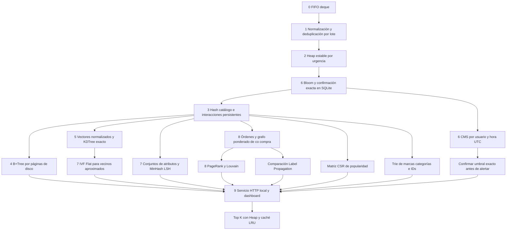

# Arquitectura del pipeline completo

El punto de entrada final es `python -m src.cli`. Los módulos `pipeline.py`
y `streaming_pipeline.py` se conservan como implementaciones históricas y
líneas base. La entrega integrada usa `CompletePipeline`.

Las etiquetas conservan la numeración académica. El filtrado se aplica
antes de actualizar estructuras para evitar que duplicados las contaminen.
El pipeline es un DAG con ramas y consumidores reales, no una colección
de demostraciones independientes. La etapa 5 normaliza los vectores que
consume IVF; las compras de la etapa 3 generan aristas para la etapa 8;
la etapa 9 combina similitudes, co-compra, influencia y popularidad CSR.

## Contrato del stream

El esquema incluye `event_id`, `event_timestamp` con zona horaria,
`event_type`, `product_id`, `user_id`, `price`, categoría, marca, sesión
y, cuando exista, `order_id`. Los IDs se normalizan a enteros, el precio
debe ser finito y no negativo y los metadatos faltantes se marcan
`unknown`. Los tipos reales de REES46 son view, cart y purchase.

Para REES46 se usa un digest BLAKE2b de 128 bits del contenido normalizado
como identidad técnica. Filas idénticas se consideran retransmisiones.
Cuando existe `source_event_id`, ese ID externo define la identidad.
Sin tal identificador es imposible distinguir perfectamente dos acciones
legítimas idénticas de una retransmisión; esta es una política explícita.

El Heap opera dentro de cada microlote y es estable. La urgencia es:
alerta crítica, compra express, compra estándar o sin urgencia conocida,
compra programada, carrito y vista. Las urgencias de envío solo están
presentes en simulación o en un stream que realmente las proporcione.
No se inventan etiquetas de envío para las filas reales de REES46.

## Tiempo y ventanas

Las frecuencias usan una clave `hora UTC | usuario`. El CMS se mantiene
durante toda la ejecución, mientras la frecuencia exacta de cada clave
se guarda en disco. Reordenar un microlote no cambia la ventana de un
evento. La cota de error es epsilon por el total de compras del sketch,
no por las compras de una ventana aislada. No hay watermark ni borrado
de ventanas: es una ejecución académica acotada con estado persistente.

## Grafo del dominio

Los nodos son productos comprados. Cada orden aporta una unidad de peso
a cada par de productos distintos de su cesta; repetir una misma compra
del mismo producto dentro de una orden no añade una nueva membresía.
El grafo es no dirigido y ponderado. Las compras sin pareja generan
nodos aislados que también reciben PageRank por teleportación.

REES46 no contiene `order_id`: se utiliza una orden inferida por sesión
y hora UTC. Se registra `order_is_inferred` y se presenta esta limitación
en el panel y el informe. El generador sintético sí contiene órdenes
explícitas con grupos de consumo controlados.

## Actualización y persistencia

Las actualizaciones exactas se confirman por microlote en SQLite, con
WAL y synchronous NORMAL. El B+Tree propio guarda nodos binarios en
páginas de 4096 bytes, hojas enlazadas y caché LRU de páginas. No usa
pickle ni un árbol entero en RAM para sus consultas.

Cada instantánea construye índices consistentes sobre el catálogo
vigente, libera la caché anterior y actualiza el servicio. Por defecto
se construye una al finalizar; `--snapshot-every N` habilita instantáneas
intermedias. Es procesamiento por microlotes, no un servicio distribuido
con garantías de latencia en tiempo real. La reconstrucción es explícita
y su costo se incluye en la ejecución integral.

El servicio consulta el B+Tree para rangos, el Trie para autocompletado,
la LRU para detalles y un Heap para Top-K. El score suma 1/(1+distancia),
Jaccard, log(1+peso de co-compra), PageRank y 0,01 log(1+popularidad CSR).
Es una heurística interpretable, no un modelo entrenado ni una afirmación
de calidad comercial. Los candidatos provienen de IVF, LSH y co-compra.

## Trazabilidad

`pipeline_summary.json` incluye los contadores por etapa, parámetros,
alertas y trazas de eventos con pertenencia al índice de precios,
vecinos ANN y consulta/actualización del grafo. Un evento sin compra
no añade una arista: su producto puede consultar influencia o conservar
valor cero si nunca se compró. Esto evita inventar relaciones.
